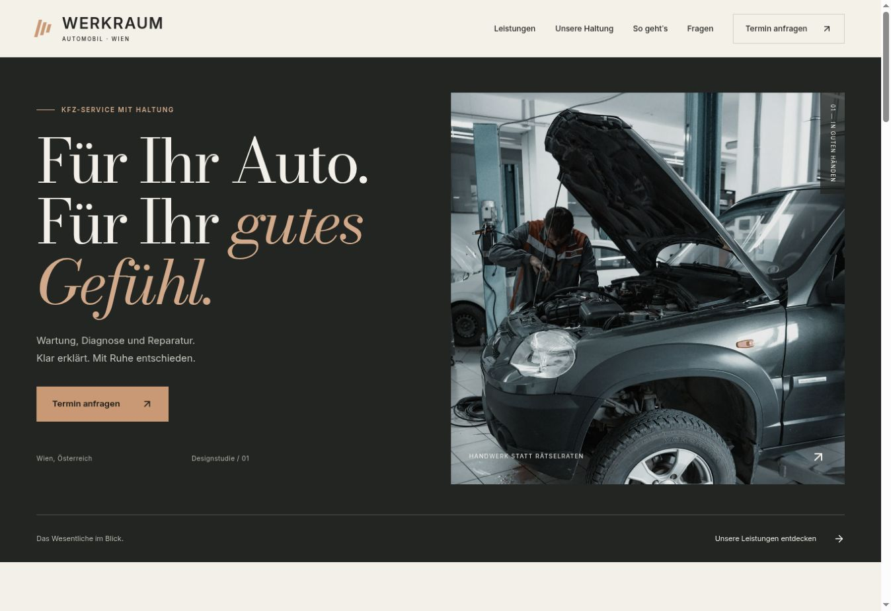

# WERKRAUM — Vienna automotive concept

Original independent design demonstration. Fictional brand, not a real workshop.

## Development

Node 22.12+ or 24+. Run `npm ci`, `npm run dev`, and `npm run build`. Output: `dist`. Vercel framework: Vite.

React + TypeScript + Vite. Six sections; keyboard-accessible menu and modal, native FAQ disclosure, service-to-form presets and local-only validated form. No tracking, cookies, database, backend or personal-data persistence. Demo forms never deliver enquiries. All imagery/fonts self-hosted. Reduced-motion supported.

## Publishing as a real business

Replace fictional brand, demo notices, contact placeholders and legal text with verified business information. Add a real enquiry service and review privacy/legal pages. Only claim §57a examination authorisation after verification. No ratings, certifications, warranties, prices or service-time claims are invented. Remove noindex only after replacing demo content and completing legal details.

## Inspiration

Principles studied from Auto-Spatny, Motus Autocenter, Lucky Car, Auto Stahl and Maroltingergarage. KFZ Holub returned a certificate-related gateway error. No reference branding, code or imagery copied.

## Photo sources
Illustrative stock photographs from Unsplash; they do not depict an actual business of this fictional brand.
- https://images.unsplash.com/photo-1625047509168-a7026f36de04 (asset identifier photo-1625047509168-a7026f36de04)
- https://images.unsplash.com/photo-1632733711679-529326f6db12 (automotive electrical work)
- https://images.unsplash.com/photo-1486262715619-67b85e0b08d3 (engine components)
License: https://unsplash.com/license/ — commercial use permitted. The original photos were resized and encoded as WebP. All fonts are self-hosted; upstream OFL license links are in FONT-LICENSES.md.

## Live website
https://vienna-auto-premium.vercel.app/

## Verification
- TypeScript and Vite production build passes.
- Responsive browser-frame checks at exact 360, 375, 390, 430, 1280, 1440 and 1920 CSS pixels; no horizontal overflow.
- Mobile menu keyboard activation, focus containment and Escape dismissal checked.
- Service links preselect the enquiry subject; required fields and email format use native validation.
- Successful form validation explicitly says that nothing was sent.
- Every internal anchor resolves; six main sections, de-AT language, local fonts and WebP assets.
- No application console errors observed; browser-extension errors are outside the application.
- These are responsive desktop-browser checks, not hardware tests or a measured Core Web Vitals audit.

## Reference synthesis
Auto-Spatny inspired editorial pacing; Motus and Lucky Car informed clear enquiry actions; Auto Stahl informed hierarchy; Maroltinger Garage reinforced the importance of real workshop imagery and understandable services. KFZ Holub could not be inspected because the browser gateway reported a certificate hostname mismatch. No reference company branding, source or imagery is reused.
